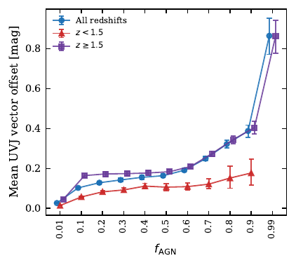
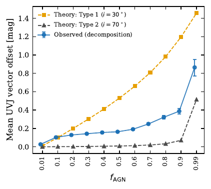
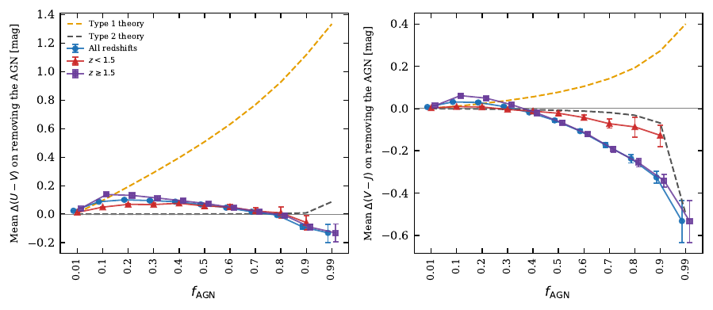
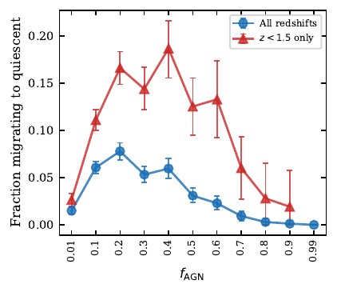
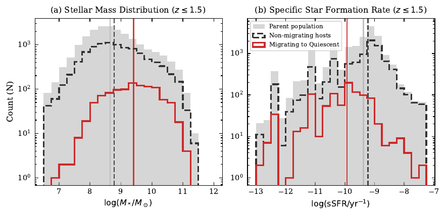
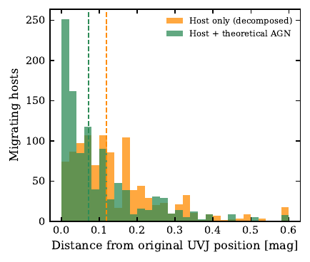
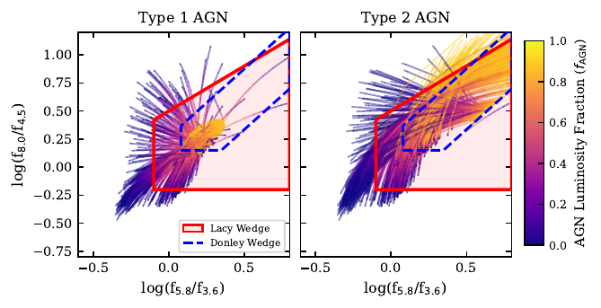
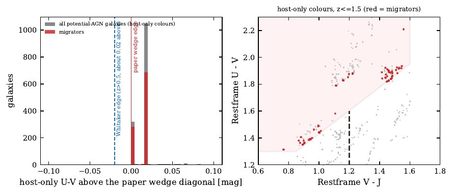
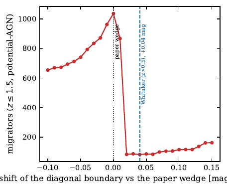
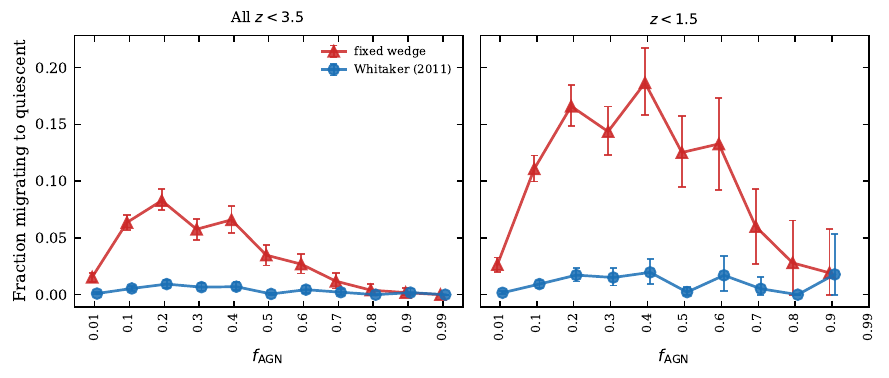

# Full-sample AGN-contamination analysis: methods, results, robustness and open questions

*Working document, 13 October 2026. Describes the analysis in this repository as it stands, including results that
limit how strongly some conclusions can be stated. Companion to the paper draft (not part of this repository).*

## 1. Aim

Active galactic nuclei (AGN) add light to their host galaxies and can change where those galaxies fall on photometric
diagnostic diagrams. This project asks how much, and in which direction, AGN light moves galaxies in the rest-frame
**UVJ** diagram (and, secondarily, in the **IRAC** colour space), using two complementary approaches:

1. **A simple forward model** (the `glass` package): a galaxy template plus a SKIRTOR AGN template, mixed with a single
   AGN luminosity fraction, with the AGN type set by the viewing angle. Predictions are summarised by the **mean vector
   offset** of the population in colour space as a function of the AGN fraction.
2. **A comparison with SED decomposition of real galaxies**: for ZFOURGE galaxies, the full best-fit SED from the CIGALE
   SED-fitting code is compared with the same SED after the best-fit AGN component is removed ("host-only").

The central quantity is therefore the **UVJ shift**: how far, and in which direction, the colours move when AGN light is
added to (model) or removed from (data) a galaxy.

## 2. Data and pipeline

**Sample.** ZFOURGE catalogues for CDFS, COSMOS and UDS: 73,790 sources; 37,647 pass the `Use==1` quality flag
(13,299 / 12,901 / 11,447). CIGALE best-fit models exist for every one of them. Rest-frame colours for the full and host-only
SEDs were derived for **37,541** galaxies (106 failed, many of them at very high redshift). Of these, **25,231 (67%)** have a
non-zero best-fit AGN fraction. A non-zero fraction in a fit does not by itself imply a detected AGN, so these are called
*potential-AGN galaxies* below. Median redshift is 1.37 (all) and 1.73 (potential-AGN galaxies), with redshifts up to about 5.7.

**Colours.** `scripts/build_useall_uvj_table.py` reads each CIGALE best-fit file, takes the total SED as the "full" SED and
the total minus the AGN components as the "host-only" SED, and computes U-V and V-J with `glass`. Recomputing the colours from
the files differs from an earlier table by a median of 0.02-0.04 mag in the colours, nearly constant in V-J. Its effect on the offsets was not quantified; it matters
for classification near a boundary.

**Re-adding an AGN.** `scripts/build_useall_recombination.py` adds a theoretical SKIRTOR AGN back onto each host-only SED,
with the mixing weight set from the CIGALE fraction (not fitted), for three templates: Type 1 (i = 30 deg), Type 2 (i = 70 deg)
and a template with CIGALE's own torus geometry.

**Analysis.** `notebooks/UseAll_CIGALE_Analysis.ipynb` (all figures and tables from the full sample),
`notebooks/UseAll_Whitaker_Wedge_Exploration.ipynb` (classification robustness, section 5) and
`notebooks/Model_Validation_via_IRAC.ipynb` (IRAC model grid). All intervals are 95% percentile bootstrap intervals
(2,000 resamples of galaxies within each AGN-fraction bin). They reflect sampling uncertainty only: per-galaxy photometric
and SED-fit uncertainties on the colours are not available from the best-fit files and are not propagated.

## 3. Main result: the UVJ shift

### 3.1 Size of the shift (mean vector offset)

The model predicts a strong dependence on AGN type: Type 1 composites move far, Type 2 composites hardly at all until the AGN
dominates. The mean offset between the full and host-only colours of the real galaxies increases with the CIGALE AGN fraction
and is smaller than the Type 1 prediction over most of the range.

| f_AGN | Type 1 model | Type 2 model | Observed, all z | Observed, z<1.5 | Observed, z>=1.5 | N (all z) |
|---|---|---|---|---|---|---|
| 0.01 | 0.01 | 0 | 0.03 [0.02, 0.03] | 0.01 | 0.04 | 4224 |
| 0.1 | 0.1 | 0 | 0.10 [0.10, 0.11] | 0.06 | 0.16 | 5763 |
| 0.2 | 0.2 | 0 | 0.13 [0.12, 0.14] | 0.08 | 0.17 | 3873 |
| 0.3 | 0.3 | 0 | 0.14 [0.13, 0.15] | 0.09 | 0.17 | 2653 |
| 0.4 | 0.41 | 0.01 | 0.16 [0.15, 0.17] | 0.11 | 0.18 | 2071 |
| 0.5 | 0.53 | 0.01 | 0.16 [0.15, 0.17] | 0.11 | 0.18 | 1774 |
| 0.6 | 0.66 | 0.01 | 0.19 [0.18, 0.20] | 0.11 | 0.21 | 1602 |
| 0.7 | 0.81 | 0.02 | 0.25 [0.24, 0.26] | 0.12 | 0.27 | 1195 |
| 0.8 | 0.98 | 0.03 | 0.32 [0.30, 0.34] | 0.15 | 0.34 | 1001 |
| 0.9 | 1.2 | 0.07 | 0.39 [0.36, 0.42] | 0.18 | 0.40 | 779 |
| 0.99 | 1.46 | 0.52 | 0.86 [0.77, 0.95] | - | 0.86 | 296 |

*Offsets in mag. Model values are means over 129 galaxy templates. Observed values are for potential-AGN galaxies; bracketed
values are 95% bootstrap intervals. The model fraction is the AGN share of the total composite flux, while the CIGALE fraction
is the AGN share of the infrared luminosity; the two are used on the same axis here.*

At fixed AGN fraction above about 0.4, galaxies at z >= 1.5 show larger offsets than galaxies at z < 1.5, and the all-redshift
curve is dominated by z >= 1.5 at high fractions (74% of the sample at a fraction of 0.5, 93% at 0.9, all at 0.99).

### 3.2 Direction of the shift (signed components)

Shift = host-only colour minus full colour, i.e. the movement on removing the AGN. A positive U-V shift is a redder U-V.

| f_AGN | mean shift in U-V | mean shift in V-J |
|---|---|---|
| 0.01 | +0.024 | +0.007 |
| 0.1 | +0.088 | +0.031 |
| 0.2 | +0.101 | +0.029 |
| 0.3 | +0.096 | +0.010 |
| 0.4 | +0.088 | -0.018 |
| 0.5 | +0.069 | -0.056 |
| 0.6 | +0.046 | -0.107 |
| 0.7 | +0.018 | -0.172 |
| 0.8 | -0.006 | -0.237 |
| 0.9 | -0.088 | -0.326 |
| 0.99 | -0.131 | -0.532 |

- **U-V:** a small positive shift (about +0.05 to +0.10 mag) up to a fraction of about 0.7, turning negative above 0.8
  (-0.13 mag at 0.99). The Type 1 model instead rises steadily to +1.34 mag at 0.99; the Type 2 model stays near zero until 0.99.
- **V-J:** slightly positive at low fractions, then increasingly negative (-0.06 at 0.5, -0.33 at 0.9, -0.53 at 0.99). The Type 2
  model also reaches about -0.5 at 0.99; the Type 1 model is positive.
- **Agreement and disagreement:** the model and the decomposition agree in sign over much of the range, in U-V at a fraction of
  about 0.1 (+0.09 observed, +0.10 Type 1), and in V-J at the highest fraction (matching the Type 2 model). They disagree in U-V at
  intermediate and high fractions, where the observed shift is 3-10 times smaller than the Type 1 model. A mixture weighted by
  the fitted inclinations (82% / 18%) does not close the gap.
- **Direction by galaxy:** at a fraction of 0.1, 79% of galaxies have a positive U-V shift; at 0.99, 18%. The share with a
  negative V-J shift rises from 44% at 0.01 to 98% at 0.9.

## 4. Supporting results

### 4.1 Which galaxies move across the quiescent boundary

Removing the AGN moves some galaxies from outside the UVJ quiescent region to inside it, and almost none the other way
(one galaxy). With the single fixed wedge used so far (U-V > 1.3, V-J < 1.6, U-V > 0.867(V-J) + 0.563), 1,038 galaxies migrate
(1,036 at z <= 1.5, 2 above), and the quiescent fraction rises from 5.5% to 8.2% overall and from 10.2% to 15.3% at z <= 1.5.
Almost no galaxy at z >= 1.5 is classified as quiescent in full photometry (4 of 37,541), so this result applies to z <~ 1.5.
**These counts are not robust to the choice of wedge; see section 5.**

### 4.2 Host properties of the galaxies that move

At z <= 1.5 the galaxies that migrate are massive and have low specific star-formation rates, between the star-forming and
already-quiescent populations (stellar mass and sSFR are catalogue values, independent of the decomposed colours):

| wedge | group | n | median log M | median log sSFR |
|---|---|---|---|---|
| fixed | migrators | 1023 | 9.41 | -9.93 |
| fixed | already quiescent in full phot. | 959 | 9.41 | -10.54 |
| fixed | at risk, do not migrate | 8500 | 8.72 | -9.19 |
| Whitaker | migrators | 100 | 9.89 | -10.11 |
| Whitaker | already quiescent in full phot. | 505 | 9.77 | -10.72 |
| Whitaker | at risk, do not migrate | 9877 | 8.79 | -9.22 |

Conditional on host properties (fixed wedge, z <= 1.5, potential-AGN galaxies not quiescent in full photometry), the migration
rate is 20-24% for log sSFR < -9.5, 5.5% for -9.5 to -9.0, and 1-3% above -9.0; by stellar mass it rises from 2% below
log M = 8 to 23% above 10. The qualitative statement (the migrating galaxies are massive, low-sSFR, close to the green valley)
holds under both wedges tested; the rates themselves do not.

### 4.3 Re-adding a theoretical AGN

For the 1,038 migrators (fixed wedge) the Type 1 and CIGALE-matched templates return 98% to their original class and the median
distance from the original UVJ position falls from 0.12 to 0.07 mag; the Type 2 template returns 1.5%. The all-galaxy
recovery (93-97%) must be read against a "do nothing" baseline of 93%: the host-only class already equals the full class for
93% of potential-AGN galaxies. This is a **consistency check of the template and its scaling**, not an independent test that
the decomposed host SED is the true host.

### 4.4 IRAC colours (Lacy wedge), model only

With the corrected IRAC colour calculation (flux densities in f_nu, as the Lacy wedge is defined) and redshifts drawn from the
full ZFOURGE sample (0 < z < 4): 36% of purely stellar templates already fall inside the wedge; at a fraction of 0.1, 46% of Type 1
and 57% of Type 2 composites do; at 0.5, 94% and 99%; Type 1 is fully inside from 0.7; Type 2 falls again at the highest fractions
(98% at 0.9, 73% at 0.99), almost entirely at z > 2. The fractions inside the wedge depend on redshift because the IRAC bands
sample different rest-frame wavelengths.

## 5. Robustness: the quiescent-boundary results depend on the wedge definition

The redshift-dependent selection of Whitaker et al. (2011, ApJ 735, 86, Eqs. 14-15) was implemented as a comparison (defined
to z < 3.5). It differs from the fixed wedge by a small amount, and the migration results change by about a factor of ten:

| sample | N | fixed: Q full % | fixed: Q host % | fixed: change (pp) | fixed: migrators | Whitaker: Q full % | Whitaker: Q host % | Whitaker: change (pp) | Whitaker: migrators |
|---|---|---|---|---|---|---|---|---|---|
| all z<3.5 | 35211 | 5.84 | 8.79 | 2.95 | 1038 | 2.59 | 2.89 | 0.3 | 105 |
| z<=1.5 | 20207 | 10.16 | 15.29 | 5.13 | 1036 | 4.48 | 4.97 | 0.49 | 100 |

Only 47 galaxies are migrators under both wedges. The cause is not the slope change. Separating the pieces:

| diagonal of the quiescent wedge | mean boundary shift (mag) | migrators (z<=1.5) | Q full % | Q host % | change (pp) |
|---|---|---|---|---|---|
| paper wedge (0.867, 0.563) | 0 | 1037 | 10.18 | 15.31 | 5.13 |
| slope only -> 0.88 | 0.014 | 888 | 8.58 | 12.98 | 4.39 |
| intercept only -> 0.59 | 0.027 | 85 | 4.72 | 5.14 | 0.42 |
| Whitaker z>0.5 diagonal (0.88, 0.59) | 0.041 | 78 | 4.64 | 5.02 | 0.39 |
| Whitaker z<0.5 diagonal (0.88, 0.69) | 0.141 | 161 | 3.9 | 4.7 | 0.8 |

The decisive effect is a **pile-up of host-only colours at the wedge edge**. Of the 1,036 migrators at z <= 1.5, 94% lie within
0.02 mag above the fixed wedge's diagonal, and their host-only colours take only 58 distinct (U-V, V-J) values (95% on six
values, the two most common 0.003 and 0.018 mag above the edge). These are discrete CIGALE host-model solutions. Whether they
count as "quiescent" is decided by whether such a model colour falls just above or just below the boundary:

| shift of the diagonal (mag) | migrators (z<=1.5) | change in quiescent fraction (pp) |
|---|---|---|
| -0.05 | 741 | 3.667 |
| -0.02 | 872 | 4.315 |
| -0 | 1037 | 5.132 |
| 0.02 | 83 | 0.411 |
| 0.04 | 82 | 0.406 |
| 0.05 | 86 | 0.426 |
| 0.1 | 115 | 0.569 |

Re-adding the AGN under the Whitaker wedge: Type 1 and matched templates return 57% of the 105 migrators (95% interval 47-67%).

| template | wedge | migrators n | migrators recovered | all potential-AGN recovered |
|---|---|---|---|---|
| Type1 | fixed | 1038 | 0.980 [0.970, 0.987] | 0.957 |
| Type1 | Whitaker | 105 | 0.571 [0.476, 0.667] | 0.969 |
| Type2 | fixed | 1038 | 0.015 [0.009, 0.024] | 0.931 |
| Type2 | Whitaker | 105 | 0.010 [0.000, 0.029] | 0.972 |
| Matched | fixed | 1038 | 0.981 [0.972, 0.988] | 0.967 |
| Matched | Whitaker | 105 | 0.571 [0.467, 0.667] | 0.971 |

**Consequence:** the direction of the effect (migration is essentially one-way) and the Type 1 versus Type 2 contrast are
robust; the **size** of the migration effect (counts, percentage-point changes, the dependence on the AGN fraction) is not,
and should be presented as illustrative and tied to a stated wedge and to the CIGALE model grid.

## 6. Framing and open questions

**What the analysis supports.** A simple, transparent mixing model predicts the sign of the AGN-induced UVJ shift, a strong
dependence on AGN type, and, in some regimes, the magnitude seen in the CIGALE decomposition. It overpredicts the U-V shift at
intermediate and high AGN fractions. The migration counts are secondary and fragile.

**Caveats that shape how the comparison should be described.**
- The "observations" are a model decomposition, so this is a comparison with an independent SED-fitting model, not with
  direct measurements of the host.
- The AGN fraction is defined differently in the model (share of total flux) and in CIGALE (share of infrared luminosity).
  Whether a matched definition changes the U-V gap has not been tested.
- No per-galaxy colour uncertainties are available; the observed mean offsets at low fractions are small (0.1-0.2 mag).
- Fixed UVJ wedge at all redshifts; almost no UVJ-quiescent galaxies at z >= 1.5 in this sample.
- 67% of galaxies have a non-zero best-fit AGN fraction; many such fractions are likely poorly constrained.

**Suggested next steps.** (i) Compare model and decomposition at a matched AGN-fraction definition. (ii) Obtain or estimate
colour uncertainties, and test whether the offsets are significant at the individual-galaxy level. (iii) Present the
boundary-crossing result as sensitive to the wedge and to the discrete model grid. (iv) Test the pile-up in a finer CIGALE grid.

## 7. Reproducing the results

1. `scripts/build_useall_uvj_table.py` then `scripts/build_useall_recombination.py` (resumable; roughly 5 minutes each with
   several workers; they read the CIGALE best-fit files under `datasets/full_zfourge_decomposed/`, which are not tracked).
2. `notebooks/UseAll_CIGALE_Analysis.ipynb` writes all figures and tables to `outputs/useall/`.
3. `notebooks/UseAll_Whitaker_Wedge_Exploration.ipynb` writes the wedge comparison to `outputs/useall/whitaker_wedge/`.
4. `notebooks/Model_Validation_via_IRAC.ipynb` needs `glass` at a version whose IRAC colours use f_nu
   (`calc_flux_nu`; the previous f_lambda calculation shifts both IRAC axes by 0.4-0.5 dex).
5. `src/paper_export.py` exports the paper figure set to `outputs/PaperFigures/` and only copies into a paper folder when
   `COPY_FIGURES_INTO_PAPER` is enabled in `src/config.py`.

Results for the earlier 10,876-galaxy subsample remain in the older notebooks and documents in this folder; they are superseded by
the full-sample analysis above.
